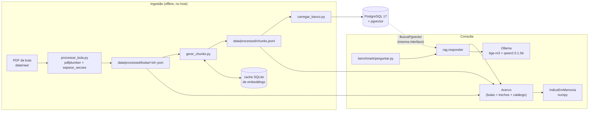
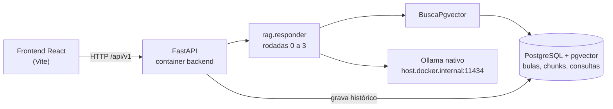
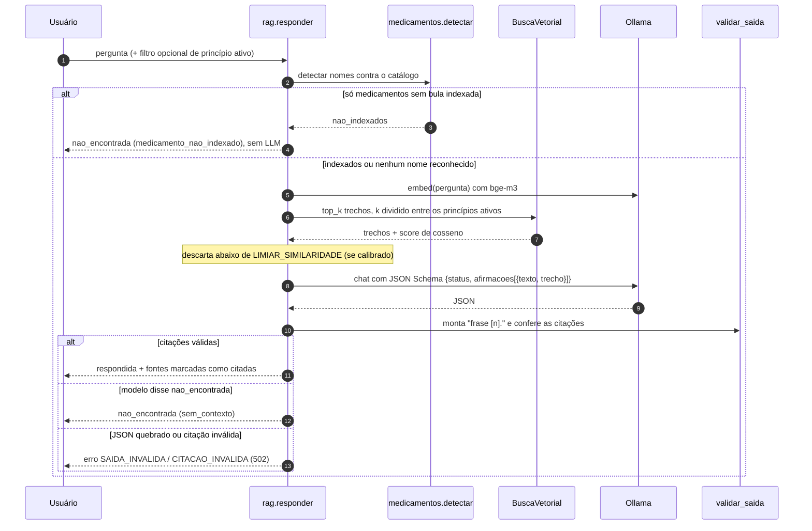
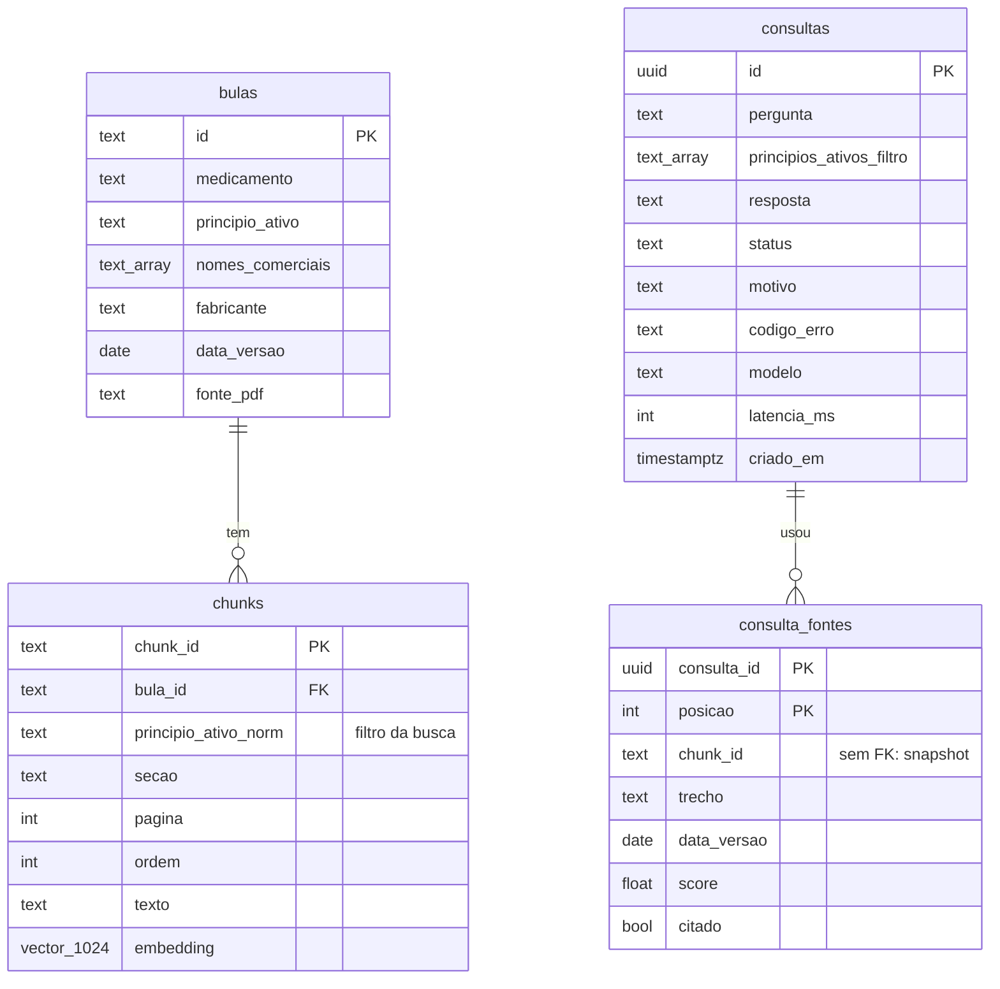
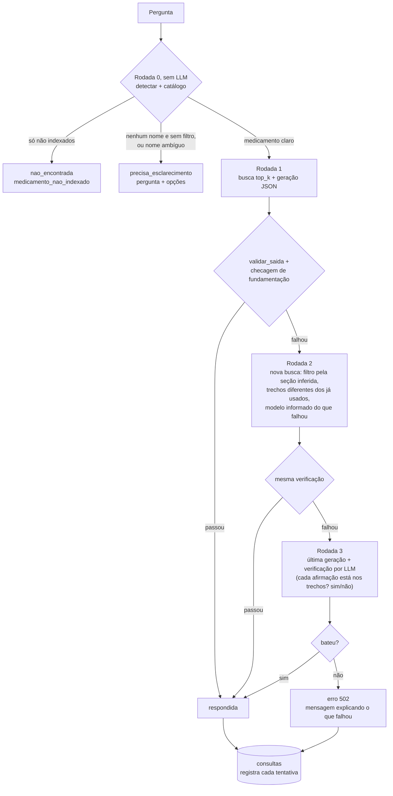
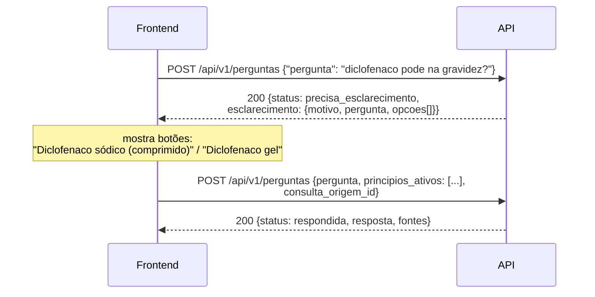
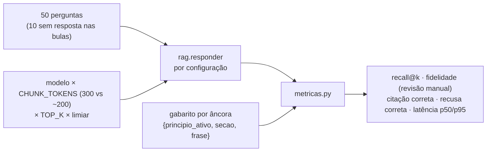

# FarmaRAG

Assistente de bulas para o balcão da farmácia: RAG (*Retrieval-Augmented Generation*) com LLM local, citação verificada no código e recusa quando a bula não sustenta a resposta.

> Projeto de portfólio, em construção. Não substitui o farmacêutico nem a leitura da bula.

## Sumário

- [Objetivo e regras](#objetivo-e-regras)
- [Estado atual](#estado-atual)
- [Arquitetura](#arquitetura)
- [Como funciona hoje](#como-funciona-hoje)
- [Modelo de dados](#modelo-de-dados)
- [Skills técnicas](#skills-técnicas)
- [Decisões e aprendizados](#decisões-e-aprendizados)
- [O que vamos implementar](#o-que-vamos-implementar)
- [Como rodar](#como-rodar)
- [Estrutura do repositório](#estrutura-do-repositório)

## Objetivo e regras

No balcão, a dúvida sobre um medicamento precisa de resposta rápida, mas a bula é longa e o PDF é difícil de pesquisar. O FarmaRAG encontra o trecho certo e responde com a fonte ao lado, para o farmacêutico ou atendente conferir.

Três regras definem o projeto e moldam o código:

| Regra | Como o código garante |
|---|---|
| Só responde com base nas bulas indexadas | O prompt recebe apenas os trechos recuperados; o JSON Schema da saída só aceita números de trechos que foram enviados |
| Toda frase traz a fonte (medicamento, seção, página, data da versão) | O modelo devolve afirmações `{texto, trecho}`; o marcador `[n]` é montado no código e `validar_saida` recusa citação inexistente |
| Prefere "não encontrei" a inventar | Detecção do medicamento antes do LLM, limiar de similaridade e status `nao_encontrada` como resultado válido, não como erro |

Tudo roda na própria máquina com [Ollama](https://ollama.com), sem API paga e sem nuvem. O hardware de desenvolvimento é só CPU (i5-10210U, 16 GB, sem GPU NVIDIA), e isso pesa em quase todas as decisões de latência.

Exemplo real, com a bula de um medicamento inventado usada nos testes:

```text
> Exemplol pode ser usado junto com ibuprofeno?

RESPOSTA
O uso com anti-inflamatórios não esteroidais, como o ibuprofeno, pode reduzir o efeito
anti-hipertensivo da exemplina e piorar a função renal [1].

TRECHOS ENVIADOS AO MODELO (* = citado na resposta)
 *[1] Exemplol 50 mg | Interações medicamentosas | p. 2 | bula de 15/03/2025 | semelhança 0.71
  [2] Exemplol 50 mg | Contraindicações | p. 2 | bula de 15/03/2025 | semelhança 0.61
  [3] Exemplol 50 mg | Indicações | p. 1 | bula de 15/03/2025 | semelhança 0.59

> Dipirona pode ser usada na gravidez?
NÃO ENCONTREI: não tenho a bula desse medicamento
```

## Estado atual

| Componente | Estado | Onde |
|---|---|---|
| Medição do hardware (etapa 0) | ✅ pronto | `benchmark/medir_ambiente.py`, `data/benchmark/resultados/` |
| Catálogo da ANVISA (6.999 pares nome comercial / princípio ativo) | ✅ pronto | `ingestao/catalogo_anvisa.py`, `data/processed/catalogo_anvisa.jsonl` |
| Detecção do medicamento na pergunta (sem LLM) | ✅ pronto | `app/services/medicamentos.py` |
| Ingestão: PDF/TXT → JSON por seção → trechos → embeddings com cache | ✅ pronto, testado só com bula inventada | `ingestao/processar_bula.py`, `ingestao/gerar_chunks.py` |
| Busca vetorial em memória (numpy) | ✅ pronto | `app/db/busca_vetorial.py` |
| Busca vetorial no PostgreSQL + pgvector | ✅ pronto, testado contra o numpy | `app/db/busca_pgvector.py`, `ingestao/carregar_banco.py` |
| Geração com saída estruturada + validação de citações | ✅ pronto (uma tentativa) | `app/services/rag.py`, `app/services/citacoes.py` |
| Teste manual pelo terminal | ✅ pronto | `python -m benchmark.perguntar` |
| Testes automáticos | ✅ 114 testes (7 precisam do PostgreSQL de pé) | `backend/tests/` |
| Bulas reais dos 40 medicamentos do MVP | ⏳ próximo passo | `data/raw/`, `data/medicamentos_mvp.json` |
| Checagem de fundamentação e rodadas 1 a 3 | 📐 desenhado | [`docs/DECISOES.md`](docs/DECISOES.md), seção 14 |
| Perguntas de esclarecimento (rodada 0) | 📐 desenhado | seção 14 |
| Benchmark de 50 perguntas | 🟡 métricas prontas, perguntas não | `benchmark/metricas.py` |
| API FastAPI | 🟡 contratos prontos, endpoints não | `app/schemas/api.py` |
| Frontend React | ⬜ não iniciado | |

## Arquitetura

### Hoje

O fluxo funciona de ponta a ponta pelo terminal. O dataset em arquivo é a fonte da verdade; o PostgreSQL é um espelho que pode ser apagado e recriado.



### Alvo



A busca fica atrás do `Protocol` `BuscaVetorial`. `IndiceEmMemoria` (numpy) e `BuscaPgvector` (`<=>`, distância de cosseno) devolvem os mesmos trechos e scores, e `rag.responder` não sabe de onde o acervo veio.

## Como funciona hoje

### 1. Ingestão

| Etapa | Arquivo | O que faz |
|---|---|---|
| Validar o PDF | `ingestao/validar_pdf_bula.py` | Checagem de segurança antes de abrir: procura JavaScript, ações automáticas e arquivos embutidos (inclusive com nome ofuscado e dentro de streams comprimidos) e calcula o SHA-256 |
| Extrair texto | `ingestao/extrair_pdf.py` | `pdfplumber`, texto por página |
| Separar seções | `ingestao/separar_secoes.py` | Regex sobre os títulos padronizados pela ANVISA (indicações, contraindicações, interações, posologia, composição, características farmacológicas, entre outras). Guarda `\f` onde a página vira |
| Montar a bula | `ingestao/processar_bula.py` | Gera `data/processed/bulas/<id>.json` validado pelo contrato `Bula` (Pydantic) |
| Dividir em trechos | `ingestao/gerar_chunks.py` | ~300 tokens com sobreposição de 50, sem misturar seções; cada trecho guarda a página em que começa. Tokens estimados em 3,3 caracteres por token |
| Embeddings | `app/llm/embeddings.py` + cache | `bge-m3` (1024 dimensões). O texto embutido leva medicamento e seção na frente. Cache SQLite com chave `hash(modelo + texto)`, gravado a cada lote de 8: interromper e retomar não refaz nada |
| Carregar o banco | `ingestao/carregar_banco.py` | `CREATE EXTENSION vector`, `create_all` e troca de `bulas` e `chunks` com `TRUNCATE` numa transação só; `consultas` não é tocada |

### 2. Consulta



Detalhes que importam:

- **Detecção do medicamento** (`services/medicamentos.py`): normaliza acento e caixa, reconhece princípio ativo, nome comercial e erro de digitação leve (só em princípio ativo). O nome mais longo vence ("Buscopan Composto" não cai na bula do Buscopan), e uma palavra que já é nome conhecido nunca é "corrigida" para outro ("prednisona" não vira "prednisolona"). Marcas do catálogo só entram com 5+ letras, de um único princípio ativo e fora de `data/aliases_ignorados.txt`.
- **Busca com mais de um medicamento**: até 3 por pergunta; o `k` é dividido entre eles, para que "ibuprofeno + losartana" traga trechos das duas bulas.
- **Saída estruturada**: o parâmetro `format` do Ollama recebe um JSON Schema em que `trecho` é um `enum` de 1 a N. O modelo não consegue citar um trecho que não recebeu.
- **Sem índice HNSW**: com poucos milhares de trechos a varredura exata leva milissegundos e dá o top-k exato; o HNSW, aproximado e com filtro, poderia devolver menos de `k`.

### 3. Erros

Cada falha tem código próprio e status HTTP definido (`app/schemas/api.py`):

| Código | HTTP | Quando |
|---|---|---|
| `MEDICAMENTO_NAO_ENCONTRADO` | 404 | Filtro com princípio ativo sem bula indexada |
| `ENTRADA_INVALIDA` | 422 | Pergunta fora de 5–500 caracteres, filtro vazio, mais de 3 medicamentos |
| `SAIDA_INVALIDA` | 502 | O modelo devolveu JSON quebrado |
| `CITACAO_INVALIDA` | 502 | Citação para trecho não enviado ou incoerente |
| `OLLAMA_INDISPONIVEL` / `BANCO_INDISPONIVEL` | 503 | Dependência fora do ar |
| `TEMPO_ESGOTADO` | 504 | Passou de `TIMEOUT_LLM_S` |

### 4. Desempenho medido (CPU)

| Medida | qwen2.5:1.5b | llama3.2:3b |
|---|---|---|
| Leitura do prompt | ~50 tokens/s | ~27 tokens/s |
| Geração | ~9 tokens/s | ~4 tokens/s |
| Pergunta com 3 trechos de 300 tokens | 30–45 s | > 90 s |
| Pergunta com trechos curtos (bula de teste) | 6–13 s | |
| Embedding `bge-m3` | ~2,5–3,4 s por trecho | |

A leitura do prompt domina a latência, então `CHUNK_TOKENS` e `TOP_K` pesam mais que o modelo. Meta revisada: mediana abaixo de 60 s com o 1.5b.

## Modelo de dados



`consulta_fontes` guarda uma cópia do trecho, sem FK para `chunks`: a tabela de trechos é recriada a cada ingestão e o histórico precisa continuar mostrando exatamente o texto e a versão da bula que o profissional viu.

## Skills técnicas

| Área | O que foi aplicado | Onde ver |
|---|---|---|
| RAG | Chunking por seção com sobreposição, embeddings multilíngues (`bge-m3`), similaridade de cosseno, filtro por metadado (princípio ativo), divisão do top-k entre entidades, citação por trecho | `ingestao/gerar_chunks.py`, `app/db/`, `app/services/rag.py` |
| LLM local | Ollama, modelo de 1,5B em CPU, saída restrita por JSON Schema (*structured output*), engenharia de prompt para modelo pequeno, medição de tokens/s | `app/llm/ollama.py`, `benchmark/medir_ambiente.py` |
| Confiabilidade | Recusa antes do LLM, validação determinística das citações, catálogo de erros com HTTP próprio, desenho de verificação em rodadas adaptativas | `app/services/citacoes.py`, `app/schemas/api.py`, `docs/DECISOES.md` §14 |
| Banco vetorial | PostgreSQL 17 + pgvector, coluna `vector(1024)`, operador `<=>`, decisão consciente de não usar HNSW, carga transacional com `TRUNCATE` | `app/db/busca_pgvector.py`, `ingestao/carregar_banco.py` |
| Python | Pydantic v2 e pydantic-settings para contratos e configuração, `typing.Protocol` para interfaces, dataclasses, numpy, SQLAlchemy 2 tipado (`Mapped`), psycopg 3, `urllib` para o cliente HTTP | `backend/app/` |
| Processamento de texto | Extração de PDF (`pdfplumber`), separação de seções por regex, normalização de nomes, tolerância a erro de digitação, rastreio de página com `\f` | `ingestao/`, `app/services/medicamentos.py` |
| Dados públicos | Dados abertos da ANVISA (228 mil registros → catálogo de 6.999 itens), validação do arquivo antes do uso, procedência com SHA-256, geração determinística | `ingestao/catalogo_anvisa.py`, `data/FONTES.md` |
| Avaliação | Gabarito por âncora (frase da bula) em vez de `chunk_id`, para comparar tamanhos de trecho; métricas de recall@k e recusa correta | `benchmark/metricas.py` |
| Testes | pytest, LLM substituído por falso, teste de equivalência numpy × pgvector, *skip* automático sem banco | `backend/tests/` |
| Engenharia | Configuração 100% por `.env`, dataset versionado no Git, Docker Compose, cache reprodutível, registro escrito de decisões | `.env.example`, `docker-compose.yml`, `docs/DECISOES.md` |

## Decisões e aprendizados

O projeto partiu de uma especificação ([`FarmaRAG.pdf`](FarmaRAG.pdf)). Tudo que mudou ao implementar, e por quê, está em [`docs/DECISOES.md`](docs/DECISOES.md), que **vale mais que o PDF**. Os pontos principais:

- **Detectar o medicamento antes de chamar o modelo.** Perguntar sobre um remédio sem bula indexada é o caso mais comum, e a resposta certa ("não tenho essa bula") é instantânea, sem os 30 s de geração.
- **Modelo pequeno não cita de forma confiável dentro do texto.** Pedindo `[1]` no meio da frase, o qwen2.5:1.5b citou só na lista e 5 de 5 respostas certas foram recusadas. Pedindo afirmações separadas e montando o `[n]` no código, 7 de 7 passaram.
- **Nenhum exemplo de resposta no prompt.** O modelo copiou o exemplo ("Deve ser tomado em jejum [2]") numa pergunta sobre armazenamento, e a validação de citações deixou passar.
- **O dataset em arquivo é a fonte da verdade.** Bulas e trechos em JSON versionado; banco e cache são derivados.
- **Gabarito por âncora.** `chunk_id` muda com `CHUNK_TOKENS`; uma frase copiada da bula, não.
- **Bulas baixadas à mão.** O Bulário da ANVISA usa Cloudflare Turnstile; o projeto não automatiza nem contorna isso, e cada PDF tem procedência e SHA-256 registrados.

## O que vamos implementar

### 1. Bulas reais

Bulas do profissional de saúde dos 40 medicamentos do MVP (`data/medicamentos_mvp.json`), baixadas à mão de fontes oficiais e registradas em `data/FONTES.md`. Com elas, ajustar `separar_secoes` ao que cada fabricante escreve: variações de título, cabeçalho e rodapé repetidos, hifenização e tabelas.

### 2. Verificação em rodadas

Hoje a validação garante que a citação existe, não que a frase está sustentada pelo trecho: uma resposta inventada com citação válida passa. Cada chamada ao LLM custa 30–45 s nesta CPU, então as rodadas são **adaptativas**: só existe uma nova tentativa se a anterior falhar.



**Checagem de fundamentação (determinística, sem LLM):** todo número, dose e unidade da resposta tem de aparecer literalmente nos trechos citados, e a maioria dos termos-chave também. É barata, explicável e pega o erro mais perigoso em bula, que é dose ou intervalo errado.

**Por que não "rodar 3 vezes e comparar":** com temperatura 0,1 as três saídas saem quase iguais, então concordância não prova correção (o erro sistemático se repete), e a latência triplicaria sempre.

Limites: `RODADAS_MAX=3` e `ORCAMENTO_S` (tempo total, ex. 150 s). Nunca devolve resposta não verificada.

### 3. Perguntas de esclarecimento

Quando o nome é ambíguo (ex.: diclofenaco sódico × gel) ou nenhum medicamento é reconhecido, o sistema pergunta de volta em vez de arriscar. A API continua sem estado: o frontend reenvia a pergunta com o filtro escolhido.



- No máximo **1** esclarecimento por pergunta, para não entrar em laço.
- Só pergunta sobre medicamento, forma farmacêutica ou seção. **Nunca** pergunta dado do paciente (idade, gestação, doenças), por causa da LGPD e da regra "não personaliza conduta".

Mudanças de contrato decorrentes: `status` ganha `precisa_esclarecimento`; `consultas` ganha `rodadas`, `tentativas` (JSON) e `consulta_origem_id` (UUID, sem FK).

### 4. Benchmark próprio



As 10 perguntas sem resposta calibram o `LIMIAR_SIMILARIDADE`, que hoje está vazio de propósito. Perguntas de interação têm duas âncoras e só contam se as duas forem recuperadas.

### 5. API

FastAPI sob `/api/v1`, com os contratos Pydantic já escritos em `app/schemas/api.py`, `BuscaPgvector` no lugar do índice em memória e cada consulta gravada em `consultas` + `consulta_fontes`.

| Método e rota | Função |
|---|---|
| `GET /api/v1/saude` | API, banco e Ollama de pé |
| `GET /api/v1/medicamentos` | Princípios ativos com bulas indexadas, para o seletor |
| `POST /api/v1/perguntas` | Pergunta → resposta, fontes, status e motivo |
| `GET /api/v1/historico?limite=20&pagina=1` | Consultas recentes |
| `GET /api/v1/historico/{consulta_id}` | Consulta completa com as fontes (snapshot) |

### 6. Frontend e entrega

Tela em React com a resposta, citações `[n]` clicáveis que abrem o trecho, fontes ao lado, aviso de medicamento não indexado, botões de esclarecimento e histórico. Depois: Docker Compose completo, resultados do benchmark publicados aqui e um vídeo curto de demonstração.

## Como rodar

Requisitos: Python 3.12, [Ollama](https://ollama.com) e Docker (só para o banco).

```powershell
# Modelos
ollama pull bge-m3
ollama pull qwen2.5:1.5b

# Ambiente Python (da raiz do repositório)
py -3.12 -m venv .venv
.venv\Scripts\activate
pip install -r backend/requirements-dev.txt
pip install -e backend
copy .env.example .env   # ajuste DB_PASSWORD; use DB_HOST=127.0.0.1

# Ingestão de uma bula
python -m ingestao.processar_bula data/raw/<bula>.pdf --medicamento "..." --principio-ativo "..." --fabricante "..." --data-versao AAAA-MM-DD
python -m ingestao.gerar_chunks

# Perguntar pelo terminal (usa os arquivos, sem banco)
python -m benchmark.perguntar "Losartana pode ser usada com ibuprofeno?"

# Banco (opcional hoje)
docker compose up -d db
python -m ingestao.carregar_banco

# Testes
pytest
```

> No Windows, use `DB_HOST=127.0.0.1`, não `localhost`: o `localhost` tenta o IPv6 primeiro e cada conexão espera ~130 s. Se já houver um PostgreSQL nativo na 5432, publique o container em outra porta (`DB_PORT=5433`).

## Estrutura do repositório

```text
farma-rag/
├── backend/
│   ├── app/
│   │   ├── config.py          # Settings (pydantic-settings), tudo vem do .env
│   │   ├── api/               # endpoints FastAPI (a implementar)
│   │   ├── db/                # models SQLAlchemy, BuscaVetorial, IndiceEmMemoria, BuscaPgvector
│   │   ├── llm/               # cliente do Ollama (chat + embed) e cálculo de embeddings
│   │   ├── schemas/           # contratos do dataset e da API, catálogo de erros
│   │   └── services/          # acervo, detecção de medicamentos, citações, rag.responder
│   └── tests/                 # pytest + fixtures (bula inventada "Exemplol")
├── ingestao/                  # PDF -> JSON -> trechos -> embeddings -> banco; catálogo ANVISA
├── benchmark/                 # medição do ambiente, métricas, teste manual (perguntar.py)
├── data/
│   ├── raw/                   # PDFs e CSV de origem (procedência em FONTES.md)
│   ├── processed/             # bulas JSON, chunks.jsonl, catálogo ANVISA (versionados)
│   ├── cache/                 # embeddings em SQLite (fora do Git)
│   └── benchmark/             # perguntas e resultados
├── docs/DECISOES.md           # correções à especificação, com motivo
├── docker-compose.yml         # pgvector/pgvector:pg17 + backend
└── FarmaRAG.pdf               # especificação original
```
