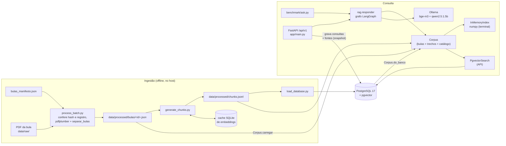
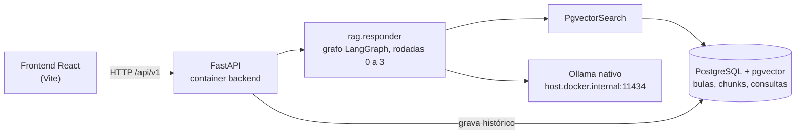
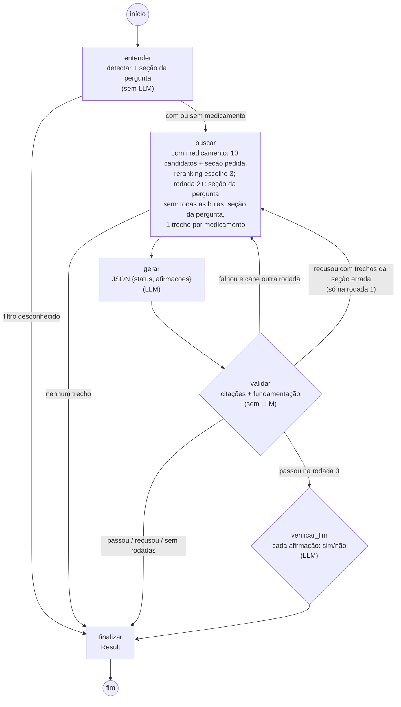
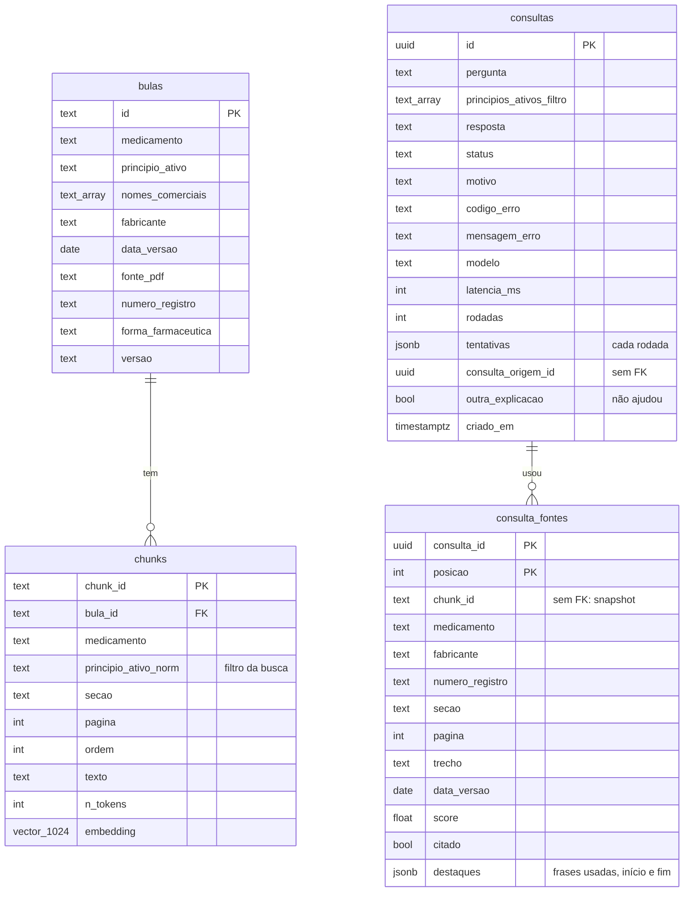
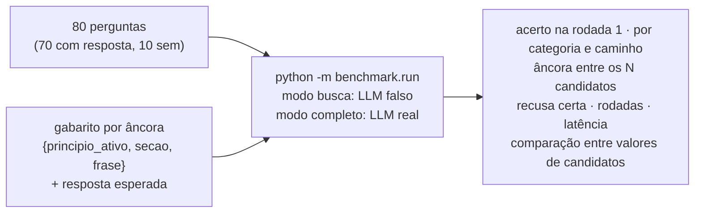

# FarmaRAG

Assistente de bulas para o balcão da farmácia: RAG (*Retrieval-Augmented Generation*) com LLM local, citação verificada no código e recusa quando a bula não sustenta a resposta.

> Projeto de portfólio, em construção. Não substitui o farmacêutico nem a leitura da bula.

## Sumário

- [Objetivo e regras](#objetivo-e-regras)
- [Estado atual](#estado-atual)
- [Arquitetura](#arquitetura)
- [Como funciona hoje](#como-funciona-hoje)
- [Modelo de dados](#modelo-de-dados)
- [Skills técnicas](#skills-técnicas)
- [Decisões e aprendizados](#decisões-e-aprendizados)
- [O que vamos implementar](#o-que-vamos-implementar)
- [Como rodar](#como-rodar)
- [Estrutura do repositório](#estrutura-do-repositório)

## Objetivo e regras

No balcão, a dúvida sobre um medicamento precisa de resposta rápida, mas a bula é longa e o PDF é difícil de pesquisar. O FarmaRAG encontra o trecho certo e responde com a fonte ao lado, para o farmacêutico ou atendente conferir.

Três regras definem o projeto e moldam o código:

| Regra | Como o código garante |
|---|---|
| Só responde com base nas bulas indexadas | O prompt recebe apenas os trechos recuperados; o JSON Schema da saída só aceita números de trechos que foram enviados |
| Toda frase traz a fonte (medicamento, fabricante, registro, seção, página, data da versão) | O modelo devolve afirmações `{texto, trecho}`; o marcador `[n]` é montado no código; `validar_saida` recusa citação inexistente e a checagem de fundamentação recusa frase que não está no trecho, frase que é só o nome do remédio e frase sobre um remédio citando a bula de outro |
| Responde qualquer pergunta sobre remédio, sempre com o que as bulas dizem | Sem remédio na pergunta ("melhor remédio pra dor de cabeça", "tenho alergia, posso tomar outro?"), **busca híbrida** em todas as bulas: semelhança, seção que a pergunta indica, palavra do assunto no trecho ("tonto" → tontura, vertigem) e um trecho por medicamento. Se nenhuma bula fala do assunto, "não encontrei", sem chamar o LLM |
| Para que serve: o que não está nas indicações da bula não é indicado | Pergunta de uso ("paracetamol serve para ansiedade?", "tomei X para Y") é respondida pela seção de indicações, sem LLM: as frases da bula e uma conclusão montada no código (citado, só dor em geral, ou "não está entre as indicações: pela bula, não é indicado"). Remédio sem bula: a classe da ANVISA, sem concluir. Pergunta com outra condição junto ("se tenho dengue", "estando grávida", "para criança") segue o caminho normal |

Tudo roda na própria máquina com [Ollama](https://ollama.com), sem API paga e sem nuvem. O hardware de desenvolvimento é só CPU (i5-10210U, 16 GB, sem GPU NVIDIA), e isso pesa em quase todas as decisões de latência.

Exemplo real (24 bulas reais, qwen2.5:1.5b na CPU, 2026-10-16):

```text
> Qual o melhor remédio pra dor de cabeça?

O ibuprofeno 400 mg cápsulas moles está indicado no alívio temporário da febre e de dores de leve
a moderada intensidade como cefaleia tensional, lombalgia, dor muscular, enxaqueca [...] [1].
Este medicamento é indicado, em adultos, para a redução da febre e o alívio temporário de dores
leves a moderadas, tais como: dores associadas a resfriados comuns, dor de cabeça [...] [2].

FONTES
 [1] Ibuprofeno 400 mg cápsula mole | Indicações | p. 2  | Geolab · Reg. ANVISA 1.5423.0333 · bula de 01/10/2025
 [2] Tylalgin 750 mg                | Indicações | p. 12 | Geolab · Reg. ANVISA 1.5423.0008 · bula de 01/05/2022
 2 rodadas · 38,8 s

> Estou tonto, qual o melhor medicamento?
Não encontrei isso nas bulas do acervo. Nenhuma das bulas consultadas fala disso.   (2 s, sem LLM)
```

## Estado atual

| Componente | Estado | Onde |
|---|---|---|
| Medição do hardware (etapa 0) | ✅ pronto | `benchmark/measure_environment.py`, `data/benchmark/resultados/` |
| Catálogo da ANVISA (6.999 pares nome comercial / princípio ativo) | ✅ pronto | `ingestion/anvisa_catalog.py`, `data/processed/catalogo_anvisa.jsonl` |
| Detecção do medicamento na pergunta (sem LLM) | ✅ pronto | `app/services/medicines.py` |
| Ingestão: PDF/TXT → JSON por seção → trechos → embeddings com cache | ✅ pronto | `ingestion/process_batch.py`, `ingestion/process_leaflet.py`, `ingestion/generate_chunks.py` |
| Busca vetorial em memória (numpy) | ✅ pronto | `app/db/vector_search.py` |
| Busca vetorial no PostgreSQL + pgvector | ✅ pronto, testado contra o numpy | `app/db/pgvector_search.py`, `ingestion/load_database.py` |
| Geração com saída estruturada + validação de citações | ✅ pronto | `app/services/rag.py`, `app/services/citations.py` |
| Agente em grafo (LangGraph, 6 nós, rodadas 1 a 3) | ✅ pronto, testado com LLM falso e com o LLM real nas 24 bulas | `app/services/graph.py` |
| Teste manual pelo terminal | ✅ pronto | `python -m benchmark.ask` |
| Testes automáticos | ✅ 390 testes (350 sem o PostgreSQL; os 40 de banco rodam num schema temporário e são pulados sem ele) | `backend/tests/` |
| Bulas reais: 31 PDFs → 37 bulas, 1.384 trechos com embedding, no banco; tabela de interações lida como tabela | ✅ 28 de 40 medicamentos do MVP, mais zolpidem, sertralina e isotretinoína | `data/bulas_manifesto.json`, `data/processed/bulas/`, `ingestion/extract_pdf.py` |
| Checagem de fundamentação (números, doses, termos, "só o nome" não vale, remédio certo), citação trocada corrigida no código e de assunto (a resposta responde à pergunta e fala do remédio perguntado) | ✅ pronto | `app/services/grounding.py`, `app/services/intent.py` |
| Pergunta sem remédio ou com remédio sem bula: busca híbrida em todas as bulas, um trecho por medicamento | ✅ pronto, testado com o LLM real | `app/services/graph.py`, `app/services/intent.py` |
| Conversa: pergunta seguinte ("e para criança?"), alergia com pergunta de volta e alternativas da mesma classe | ✅ pronto, testado com o LLM real | `app/services/graph.py`, `app/services/intent.py` |
| Respostas copiadas da bula, sem LLM (dose, interação entre remédios citados, alternativas na alergia) | ✅ pronto | `app/services/extract.py` |
| Para que serve, pelas indicações da bula, com conclusão (citado / geral / não indicado) | ✅ pronto, testado com LLM falso | `app/services/indication.py` |
| Reranking da rodada 1 (seção pedida, assunto, sem repetir trecho) e benchmark de 80 perguntas por âncora | ✅ pronto; 44/70 → 57/70 no modo busca | `app/services/rerank.py`, `benchmark/run.py`, `data/benchmark/perguntas.jsonl` |
| Para que serve o remédio sem bula: classe terapêutica do registro na ANVISA | ✅ pronto | `app/services/medicines.py` |
| "Não ajudou": outra explicação sem os trechos citados, e destaque das frases da bula que sustentam cada afirmação | ✅ pronto no grafo, na API e na tela, testado com LLM falso (LLM real na quinta) | `app/services/graph.py`, `app/services/grounding.py`, `app/api/routes.py`, `frontend/src/components/` |
| Aviso de saúde fixo em toda resposta respondida, montado pela API (nunca pelo LLM) | ✅ pronto na API e na tela; asserções de banco ainda não rodaram | `app/schemas/api.py` (`AVISO_SAUDE`), `frontend/src/components/Message.tsx` |
| Seção da pergunta já na rodada 1 e seções raras (eficácia, farmacologia) só quando pedidas | ✅ pronto, testado com LLM falso; efeito no benchmark a medir na quinta (`RERANK_GARANTE_SECAO`) | `app/services/rerank.py`, `app/services/intent.py` |
| Modelos aquecidos no Ollama ao subir a API e `KEEP_ALIVE` no `.env` | ✅ pronto, testado com Ollama falso; ganho em segundos a medir na quinta | `app/llm/ollama.py`, `app/main.py` |
| Progresso de verdade na tela: a API avisa cada etapa do agente (buscando, escrevendo, conferindo, verificando) | ✅ pronto; transporte conferido por HTTP de verdade, rotas de banco ainda não rodaram | `app/api/progress.py`, `app/services/graph.py`, `frontend/src/api.ts` |
| Benchmark de 50 perguntas | 🟡 métricas prontas, perguntas não | `benchmark/metrics.py` |
| API FastAPI: 6 endpoints, histórico de toda consulta | ✅ pronta, testada com LLM falso e no servidor (perguntas sem LLM) | `app/main.py`, `app/api/`, `app/services/history.py` |
| Frontend React (Vite + TypeScript) em formato de chat: conversa, citações clicáveis, fontes em chips, histórico na lateral | ✅ pronto, conferido no navegador com o LLM real e com o simulado | `frontend/` |

## Arquitetura

### Hoje

O fluxo funciona de ponta a ponta pelo terminal (lendo os arquivos) e pela API (lendo o banco). O dataset em arquivo é a fonte da verdade; `bulas` e `chunks` no PostgreSQL são um espelho que pode ser apagado e recriado. O histórico de consultas só existe no banco.



### Alvo



A busca fica atrás do `Protocol` `VectorSearch`. `InMemoryIndex` (numpy) e `PgvectorSearch` (`<=>`, distância de cosseno) devolvem os mesmos trechos e scores, e `rag.responder` não sabe de onde o acervo veio.

## Como funciona hoje

### 1. Ingestão

| Etapa | Arquivo | O que faz |
|---|---|---|
| Validar o PDF | `ingestion/validate_leaflet_pdf.py` | Checagem de segurança antes de abrir: procura JavaScript, ações automáticas e arquivos embutidos (inclusive com nome ofuscado e dentro de streams comprimidos) e calcula o SHA-256 |
| Extrair texto | `ingestion/extract_pdf.py` | `pdfplumber`, texto por página |
| Separar bulas | `ingestion/split_sections.py` | Um PDF pode trazer várias bulas (Tylalgin: gotas, comprimido e sachê). Cada uma termina na tabela "Histórico de Alteração", que é descartada, e a próxima começa em "MODELO DE BULA..." (ou, na EMS, que não imprime esse cabeçalho, em "I - IDENTIFICAÇÃO DO MEDICAMENTO": AAS 500 e 100 mg no mesmo PDF). Lê também o código de versão impresso e o nº de registro de cada uma |
| Separar seções | `ingestion/split_sections.py` | Regex sobre os títulos padronizados pela ANVISA, com as variações das bulas reais (singular, erro de digitação, rodapé colado no título). Remissão "(veja o item 8. POSOLOGIA...)" não abre seção; referências bibliográficas são puladas; hífen de palavra composta no fim da linha é mantido. Guarda `\f` onde a página vira |
| Montar as bulas | `ingestion/process_batch.py` | Lê `data/bulas_manifesto.json` e, antes de gravar, confere SHA-256 (o mesmo do `FONTES.md`), quantas bulas há no PDF e o registro impresso em cada uma. Gera `data/processed/bulas/<id>.json` pelo contrato `Leaflet`, com registro, forma farmacêutica e versão. `process_leaflet.py` faz o mesmo para uma bula avulsa |
| Dividir em trechos | `ingestion/generate_chunks.py` | ~300 tokens com sobreposição de 50, sem misturar seções; cada trecho guarda a página em que começa. Tokens estimados em 3,3 caracteres por token |
| Embeddings | `app/llm/embeddings.py` + cache | `bge-m3` (1024 dimensões). O texto embutido leva medicamento e seção na frente. Cache SQLite com chave `hash(modelo + texto)`, gravado a cada lote de 8: interromper e retomar não refaz nada |
| Carregar o banco | `ingestion/load_database.py` | `CREATE EXTENSION vector`, `create_all` e troca de `bulas` e `chunks` com `TRUNCATE` numa transação só; `consultas` não é tocada |

### 2. Consulta: o agente em grafo (LangGraph)

`rag.responder` executa um grafo de 6 nós (`app/services/graph.py`). Só 2 chamam o LLM; os caminhos são decididos nas arestas condicionais, em código. Cada chamada ao LLM custa 30–45 s nesta CPU, então as rodadas são **adaptativas**: uma nova só começa se a anterior falhou e se ainda cabe no orçamento de tempo.



| Nó | LLM | O que faz |
|---|---|---|
| `entender` | não | Detecta o medicamento (ou aplica o filtro) e infere as seções da pergunta (`services/intent.py`: "gravidez" → contraindicações e advertências, "dose" → posologia…) |
| `buscar` | não (embedding, 1 vez só) | Pergunta de para que serve: as frases da seção de indicações e a conclusão (`services/indication.py`), sem LLM; de remédio sem bula, nem busca. Com medicamento indexado: rodada 1, os 10 mais parecidos de cada remédio mais os melhores da seção pedida, e o **reranking** (`services/rerank.py`) escolhe os top_k; rodadas seguintes, trechos das seções indicadas, os ainda não usados primeiro. Sem medicamento indexado (nenhum nome, ou só remédio sem bula): **busca geral**, todas as bulas, só nas seções indicadas e um trecho por princípio ativo (`TOP_K_GERAL=4`), para a resposta trazer as opções. No "não ajudou", começa como numa rodada seguinte: sem os trechos citados na resposta anterior e com os já enviados no fim da fila |
| `gerar` | **sim** | Geração com JSON Schema. Da rodada 2 em diante, uma observação genérica diz o que falhou (sem repetir a afirmação errada, que o modelo copiaria). Se a pergunta cita remédio sem bula, a observação avisa que não há trechos dele, para o modelo não atribuir a ele o que a bula de outro diz |
| `validar` | não | `validar_saida` + checagem de fundamentação (`services/grounding.py`): todo número tem de estar no trecho citado, todo número com unidade de dose com a mesma unidade, a maioria dos termos da frase também, algum termo além do nome do remédio tem de estar no texto do trecho, e remédio citado na frase tem de ser o do trecho ou aparecer nele. Antes, a citação trocada é corrigida no código: frase que não está no trecho citado, mas está inteira em outro trecho enviado do mesmo remédio (ou de um remédio que a frase nomeia), passa a citar esse trecho, e frase repetida sai (antes custava uma rodada). Depois, remédio nomeado na pergunta e citado num trecho enviado tem de aparecer na resposta (DECISOES §31) |
| `verificar_llm` | **sim** | Só na rodada 3: "o trecho diz isso? sim/não" por afirmação. Pode usar um modelo maior (`LLM_MODELO_VERIFICACAO`) sem deixar a pergunta comum mais lenta |
| `finalizar` | não | Monta o `Result` com as rodadas, cada tentativa e o motivo de cada reprovação |

Nenhuma resposta não verificada sai do grafo: se as rodadas acabam (`RODADAS_MAX=3`) ou o tempo acaba (`ORCAMENTO_S=150`), a resposta é **erro 502 com a explicação de cada rodada**. Na prática a maioria das perguntas termina na rodada 1, com uma chamada ao LLM.

**Por que não "rodar 3 vezes e comparar":** com temperatura 0,1 as três saídas saem quase iguais, então concordância não prova correção (o erro sistemático se repete), e a latência triplicaria sempre.

Detalhes que importam:

- **Detecção do medicamento** (`services/medicines.py`): normaliza acento e caixa, reconhece princípio ativo, nome comercial e erro de digitação leve (só em princípio ativo). O nome mais longo vence ("Buscopan Composto" não cai na bula do Buscopan), e uma palavra que já é nome conhecido nunca é "corrigida" para outro ("prednisona" não vira "prednisolona"). Marcas do catálogo só entram com 5+ letras, de um único princípio ativo e fora de `data/aliases_ignorados.txt`.
- **Busca com mais de um medicamento**: até 3 por pergunta; o `k` é dividido entre eles, para que "ibuprofeno + losartana" traga trechos das duas bulas.
- **Saída estruturada**: o parâmetro `format` do Ollama recebe um JSON Schema em que `trecho` é um `enum` de 1 a N. O modelo não consegue citar um trecho que não recebeu.
- **Sem índice HNSW**: com poucos milhares de trechos a varredura exata leva milissegundos e dá o top-k exato; o HNSW, aproximado e com filtro, poderia devolver menos de `k`.

### 3. Erros

Cada falha tem código próprio e status HTTP definido (`app/schemas/api.py`):

| Código | HTTP | Quando |
|---|---|---|
| `MEDICAMENTO_NAO_ENCONTRADO` | 404 | Filtro com um nome que o catálogo não conhece (conhecido sem bula segue como remédio sem bula) |
| `CONSULTA_NAO_ENCONTRADA` | 404 | `GET /historico/{id}` ou "não ajudou" de uma consulta que não existe |
| `ENTRADA_INVALIDA` | 422 | Pergunta fora de 5–500 caracteres, filtro vazio, mais de 3 medicamentos, paginação inválida, "não ajudou" de consulta que não é resposta |
| `SAIDA_INVALIDA` | 502 | O modelo devolveu JSON quebrado até a última rodada |
| `CITACAO_INVALIDA` | 502 | Citação para trecho não enviado ou incoerente até a última rodada |
| `RESPOSTA_NAO_VERIFICADA` | 502 | Nenhuma rodada passou na fundamentação ou na verificação; a mensagem explica cada rodada |
| `OLLAMA_INDISPONIVEL` / `BANCO_INDISPONIVEL` | 503 | Dependência fora do ar (ou banco sem bulas carregadas) |
| `TEMPO_ESGOTADO` | 504 | Passou de `TIMEOUT_LLM_S` |

Na API, todo erro sai no mesmo formato, `{"erro": {"codigo", "mensagem"}}` (`ErrorOut`), inclusive a validação de entrada do FastAPI.

### 4. Desempenho medido (CPU)

| Medida | qwen2.5:1.5b | llama3.2:3b |
|---|---|---|
| Leitura do prompt | ~50 tokens/s | ~27 tokens/s |
| Geração | ~9 tokens/s | ~4 tokens/s |
| Pergunta com 3 trechos de 300 tokens | 30–45 s | > 90 s |
| Pergunta com trechos curtos (bula de teste) | 6–13 s | |
| Embedding `bge-m3` | ~2,5–3,4 s por trecho | |

A leitura do prompt domina a latência, então `CHUNK_TOKENS` e `TOP_K` pesam mais que o modelo. Meta revisada: mediana abaixo de 60 s com o 1.5b.

### 5. API

FastAPI em `app/main.py`, rotas em `app/api/routes.py`, documentação interativa em `http://127.0.0.1:8000/docs`.

| Método e rota | Função |
|---|---|
| `GET /api/v1/saude` | Banco, Ollama e modelos baixados. Sempre 200: `status` é `ok` ou `degradado`, com a lista do que falta |
| `GET /api/v1/medicamentos` | Princípios ativos com bula indexada e as bulas de cada um (fabricante, forma, data), para o seletor |
| `POST /api/v1/perguntas` | `{pergunta, principios_ativos?, consulta_origem_id?}` → resposta, fontes, status, rodadas. Erro sai em `ErrorOut`, com o HTTP do catálogo |
| `POST /api/v1/perguntas/com-progresso` | O mesmo que `POST /perguntas`, em fluxo NDJSON: uma linha por etapa do agente (`{"tipo":"etapa","etapa":"buscando","rodada":1,"de":3}`) e, no fim, `{"tipo":"resposta",...}` ou `{"tipo":"erro",...}`. A tela usa esta |
| `POST /api/v1/perguntas/{consulta_id}/outra-explicacao/com-progresso` | O "não ajudou" em fluxo, como a rota acima |
| `POST /api/v1/perguntas/{consulta_id}/outra-explicacao` | "Não ajudou": a pergunta da consulta de novo, sem os trechos citados nela e nas explicações antes dela. Sem corpo; mesma resposta do `POST /perguntas`, com `outra_explicacao: true` |
| `GET /api/v1/historico?limite=20&pagina=1` | Consultas da mais recente para a mais antiga, com o total |
| `GET /api/v1/historico/{consulta_id}` | A consulta como foi respondida, com as fontes do snapshot |

- **O acervo vem do banco** (`Corpus.do_banco`): bulas e trechos são lidos uma vez, ao subir, e a busca é a `PgvectorSearch`. Depois de rodar `python -m ingestion.load_database`, reinicie a API.
- **Toda pergunta fica no histórico**, inclusive esclarecimento e erro: status, rodadas, cada tentativa (`tentativas`, em JSON, com a saída crua do modelo), a mensagem do erro e o `consulta_origem_id` do reenvio depois de um esclarecimento.
- **A resposta sai do snapshot gravado**: as fontes do `POST` são as mesmas que o histórico mostra depois, com fabricante, nº de registro, seção (chave e rótulo), página, data da bula, `citado` e `destaques` (as frases do trecho que sustentam a resposta). Os trechos consultados e não citados também vêm.
- **Sobe sem o banco**: com o PostgreSQL fora do ar, a API sobe, responde 503 `BANCO_INDISPONIVEL` e tenta de novo a cada requisição. `DB_TIMEOUT_S` (5 s) corta a espera de ~130 s que o Windows faz por conexão.
- **Endpoints síncronos** (`def`): o FastAPI roda cada um numa thread à parte, e a pergunta espera o Ollama por dezenas de segundos.
- **Progresso** (`app/api/progress.py`, DECISOES §36): nas rotas `com-progresso` a pergunta roda numa thread e cada etapa vira uma linha de JSON na hora; `{"tipo":"vivo"}` a cada 15 s segura proxies. Erros de antes do agente (422, 404, 503) saem como HTTP comum; os que o agente descobre vão na linha `erro`, com o `status` que teriam. Se a tela fechar a conexão, a consulta termina e fica no histórico.
- **Aviso de saúde** (`aviso` em `AnswerOut` e `InquiryDetail`): o texto fixo de `AVISO_SAUDE`, só quando `status = respondida`. É calculado ao responder, não é gravado e não passa pelo LLM (DECISOES §33).
- **Ao subir**, a API carrega no Ollama os modelos de embeddings e de geração em segundo plano (`AQUECER_MODELOS`, `KEEP_ALIVE`; DECISOES §35), sem atrasar a subida nem falhar se o Ollama estiver fora.

### 6. Frontend

React 19 + TypeScript, servido pelo Vite (`frontend/`), em `http://127.0.0.1:5173`. Formato de chat, como Claude e ChatGPT, e nenhuma biblioteca além do React:

- **Conversa**: a pergunta em balão, a resposta ao lado do ícone, com cada `[n]` clicável. Embaixo, as fontes em chips (medicamento e seção); o clique abre o trecho inteiro da bula com fabricante, nº de registro, página, data e se foi usado na resposta. Caixa de mensagem que cresce com o texto (Enter envia, Shift+Enter quebra a linha) e tela inicial com sugestões de pergunta. Sem filtro de medicamento: o sistema acha o remédio na pergunta ou busca em todas as bulas.
- **Estados** dentro da conversa: pensando (a etapa real que a API avisa, como "Buscando nos trechos das bulas" ou "Rodada 2 de 3: buscando outros trechos", mais uma frase leve e os segundos contando: na CPU leva de 10 a 45 s), não encontrada (com os trechos consultados), aviso de remédio sem bula no acervo, esclarecimento (botões, para a ambiguidade de forma farmacêutica) e erro com título claro. No 502, cada rodada que falhou vira um item da lista.
- **Aviso de saúde**: embaixo de toda resposta respondida, em texto pequeno e discreto: "Informação da bula, para conferência. Não substitui a avaliação do farmacêutico nem a consulta médica."
- **Barra lateral**: "Nova pergunta" e o histórico agrupado em Hoje, Ontem, Últimos 7 dias e Anteriores; o clique abre a consulta como estava na hora. No celular, a barra vira menu.
- **Saúde**: o rodapé da barra mostra se API, banco e Ollama estão no ar (conferido a cada 30 s), e uma faixa no topo da conversa lista o que falta.
- Em desenvolvimento, o Vite repassa `/api` para a API (`127.0.0.1:8000`): mesma origem, sem depender de CORS. Tema claro e escuro, pelo sistema operacional.

### 7. Conversa e respostas copiadas da bula

- **Pergunta seguinte**: a tela manda a última resposta (`consulta_origem_id`) e a API busca a pergunta anterior no histórico, sem guardar estado. "E para criança?" continua sobre o remédio da anterior; "e com varfarina?" junta o remédio novo com o anterior; "qual o melhor remédio para tosse?" é assunto novo.
- **Alergia**: "tenho alergia a um remédio, tem outro?" pergunta de volta qual é. Com o nome, a resposta traz a contraindicação por hipersensibilidade da bula dele e as alternativas da **mesma classe terapêutica no registro da ANVISA** (dipirona → ibuprofeno e paracetamol). A tela lembra de conferir a alergia cruzada.
- **Frases da bula, sem o LLM**: em pergunta de dose (uma frase da posologia por apresentação), em interação entre remédios citados e nas alternativas, a resposta são as frases da bula como estão escritas (na tabela de interações, a linha inteira). Saem em 2 a 5 s, sem o modelo juntar linhas erradas.
- **Para que serve**: remédio sem bula no acervo vem com a classe terapêutica do registro na ANVISA ("dipirona: analgésicos não narcóticos").

### 8. "Não ajudou" e destaque na fonte

O balconista aperta "não ajudou, explique de outro jeito" embaixo da última resposta e o agente refaz a resposta com outros trechos, com a mesma validação e sempre com fonte. O agente não pede isso sozinho: resposta fraca continua sendo resolvida pelas rodadas.

- **Sem os trechos citados**: a pergunta roda de novo sem os trechos que a resposta anterior citou (e as outras explicações antes dela). Os enviados e não citados continuam valendo, mas depois dos que nunca foram enviados.
- **Seção antes da semelhança**: com seção indicada pela pergunta, a busca começa por ela, como nas rodadas 2 e 3. Se todos os trechos da seção já foram citados, não há outra explicação: `nao_encontrada` com motivo `sem_outra_explicacao`, sem chamar o LLM. Recusa do modelo também vira esse motivo.
- **Sempre pelo LLM**: sem frases copiadas da bula, porque a cópia pode ter sido o que não ajudou e, como os trechos se sobrepõem, a frase copiada sairia a mesma.
- **O prompt não muda**: nem a resposta anterior nem "explique de outro jeito" entram no prompt, porque o modelo pequeno copia o que vê. A diferença vem dos trechos.
- **Destaque** (`grounding.destaques`, sem LLM): de cada fonte citada, as frases inteiras do trecho que sustentam as afirmações, como posições (início, fim) no texto. Frase copiada da bula: as frases onde ela está. Paráfrase do modelo: as frases que mais cobrem os termos e números da afirmação, uma por vez, até no máximo 3; a primeira precisa cobrir pelo menos dois itens, e o nome do remédio não conta.

- **Na API** (`POST /perguntas/{id}/outra-explicacao`): a tela manda só o id da resposta que não ajudou. A API segue a cadeia no histórico (`history.explicacoes`) até a pergunta original e monta o `AnotherExplanation` (`history.para_outra_explicacao`): evita os trechos citados em toda a cadeia; os enviados em qualquer rodada (`tentativas`) vão para o fim da fila. Roda com a pergunta, o filtro e a pergunta anterior da conversa da original, e grava uma consulta nova com `consulta_origem_id` = a que não ajudou e `outra_explicacao = true`. Só resposta `respondida` pede outra explicação (senão, 422).
- **Na tela**: o botão fica só na última resposta respondida; o pedido aparece na conversa como "Não ajudou, explique de outro jeito." e a resposta nova vem com "Outra explicação, com trechos diferentes dos que já foram citados". Sem trecho novo: "Não há outra explicação nas bulas do acervo". No cartão da fonte, as frases dos `destaques` aparecem marcadas; na barra lateral, a consulta aparece como "Outra explicação: <pergunta>".

## Modelo de dados



`consulta_fontes` guarda uma cópia do trecho, sem FK para `chunks`: a tabela de trechos é recriada a cada ingestão e o histórico precisa continuar mostrando exatamente o texto e a versão da bula que o profissional viu.

## Skills técnicas

| Área | O que foi aplicado | Onde ver |
|---|---|---|
| RAG | Chunking por seção com sobreposição, embeddings multilíngues (`bge-m3`), similaridade de cosseno, filtro por metadado (princípio ativo), divisão do top-k entre entidades, citação por trecho | `ingestion/generate_chunks.py`, `app/db/`, `app/services/rag.py` |
| LLM local | Ollama, modelo de 1,5B em CPU, saída restrita por JSON Schema (*structured output*), engenharia de prompt para modelo pequeno, medição de tokens/s | `app/llm/ollama.py`, `benchmark/measure_environment.py` |
| Confiabilidade | Recusa antes do LLM, validação determinística das citações, checagem de fundamentação (números, doses e termos no trecho citado), verificação por LLM só na última rodada, destaque das frases que sustentam cada afirmação (cobertura gulosa de termos, sem LLM), catálogo de erros com HTTP próprio | `app/services/citations.py`, `app/services/grounding.py`, `app/schemas/api.py` |
| Agentes | LangGraph: estado tipado (`TypedDict`), nós com responsabilidade única, decisões em arestas condicionais determinísticas, laço de rodadas com limite e orçamento de tempo, modelo diferente por nó, nova execução com estado inicial próprio ("não ajudou") | `app/services/graph.py`, `docs/DECISOES.md` §16 |
| Banco vetorial | PostgreSQL 17 + pgvector, coluna `vector(1024)`, operador `<=>`, decisão consciente de não usar HNSW, carga transacional com `TRUNCATE` | `app/db/pgvector_search.py`, `ingestion/load_database.py` |
| Python | Pydantic v2 e pydantic-settings para contratos e configuração, `typing.Protocol` para interfaces, dataclasses, numpy, SQLAlchemy 2 tipado (`Mapped`), psycopg 3, `urllib` para o cliente HTTP | `backend/app/` |
| Processamento de texto | Extração de PDF (`pdfplumber`), separação de seções por regex, normalização de nomes, tolerância a erro de digitação, rastreio de página com `\f` | `ingestion/`, `app/services/medicines.py` |
| Dados públicos | Dados abertos da ANVISA (228 mil registros → catálogo de 6.999 itens), validação do arquivo antes do uso, procedência com SHA-256, geração determinística | `ingestion/anvisa_catalog.py`, `data/FONTES.md` |
| Avaliação | Gabarito por âncora (frase da bula) em vez de `chunk_id`, para comparar tamanhos de trecho; métricas de recall@k e recusa correta | `benchmark/metrics.py` |
| API | FastAPI com *lifespan*, injeção de dependência, todo erro no mesmo formato (handlers próprios, inclusive para a validação de entrada), endpoints síncronos para chamada bloqueante, CORS, OpenAPI gerado | `app/main.py`, `app/api/` |
| Testes | pytest, LLM substituído por falso, teste de equivalência numpy × pgvector, API testada com `TestClient` contra banco real num schema temporário isolado (`schema_translate_map`), *skip* automático sem banco | `backend/tests/` |
| Frontend | React 19 com hooks, TypeScript estrito com tipos espelhando os contratos da API, estados de carregamento e erro, citações clicáveis ligadas às fontes, tema claro/escuro por variáveis CSS, layout responsivo, dependências fixadas e instaladas sem scripts | `frontend/src/` |
| Engenharia | Configuração 100% por `.env`, dataset versionado no Git, Docker Compose, cache reprodutível, registro escrito de decisões, convenção de nomes (código em inglês, domínio em português) | `.env.example`, `docker-compose.yml`, `docs/DECISOES.md` |

## Decisões e aprendizados

O projeto partiu de uma especificação ([`FarmaRAG.pdf`](FarmaRAG.pdf)). Tudo que mudou ao implementar, e por quê, está em [`docs/DECISOES.md`](docs/DECISOES.md), que **vale mais que o PDF**. Os pontos principais:

- **Toda pergunta tem resposta das bulas.** Antes, pergunta sem nome de remédio voltava com "sobre qual medicamento?" e remédio sem bula com "não tenho essa bula". No uso real isso pareceu "não respondeu nada": agora as duas buscam em todas as bulas, na seção que a pergunta indica, e a resposta diz de qual medicamento é cada informação.
- **Quando a resposta é uma frase da bula, copiar em vez de gerar.** O modelo de 1,5B juntou a linha do clopidogrel com a da varfarina ("deve ser evitado", quando a bula manda monitorar o INR). Copiada, a resposta sai certa e em 2 s.
- **Busca por semelhança sempre acha alguma coisa.** "Estou tonto" trazia as indicações do paracetamol. Na busca em todas as bulas, o trecho precisa ter a palavra do assunto (tontura, vertigem); sem isso, "não encontrei" é a resposta certa.
- **Modelo pequeno não cita de forma confiável dentro do texto.** Pedindo `[1]` no meio da frase, o qwen2.5:1.5b citou só na lista e 5 de 5 respostas certas foram recusadas. Pedindo afirmações separadas e montando o `[n]` no código, 7 de 7 passaram.
- **Nenhum exemplo de resposta no prompt.** O modelo copiou o exemplo ("Deve ser tomado em jejum [2]") numa pergunta sobre armazenamento, e a validação de citações deixou passar.
- **Outra explicação vem de outros trechos, não de outro prompt.** Pelo mesmo motivo, o "não ajudou" não manda a resposta anterior nem "explique de outro jeito" ao modelo: tira os trechos que ela citou e deixa o prompt igual.
- **O dataset em arquivo é a fonte da verdade.** Bulas e trechos em JSON versionado; banco e cache são derivados.
- **Gabarito por âncora.** `chunk_id` muda com `CHUNK_TOKENS`; uma frase copiada da bula, não.
- **Bulas baixadas à mão.** O Bulário da ANVISA usa Cloudflare Turnstile; o projeto não automatiza nem contorna isso, e cada PDF tem procedência e SHA-256 registrados.

## O que vamos implementar

### 1. Bulas reais

28 dos 40 medicamentos do MVP (`data/medicamentos_mvp.json`), mais zolpidem, sertralina e isotretinoína (perguntas reais que voltavam "não encontrei"), viraram 37 bulas, com trechos e embeddings no banco. O lote 3 (2026-10-18) teve a procedência de cada site analisada antes do download (`data/FONTES.md`): Geolab, o portal de bulas da EMS (sara.com.br) e Libbs. Dos 12 restantes, 3 aguardam decisão por ressalva de procedência (Abbott, Germed, Sandoz) e os outros ficam para download manual no Bulário Eletrônico. A tabela de interações já é lida como tabela; as outras (ex.: doses por peso) ainda saem como texto corrido.

### 2. O que falta do agente

- **"Não ajudou" com o LLM real**: pronto no grafo, na API e na tela (item 8 de [Como funciona hoje](#como-funciona-hoje)), testado só com o modelo falso; falta ver, na quinta, se a outra explicação do qwen2.5:1.5b com os trechos novos passa na fundamentação.
- **Forma farmacêutica ambígua** (Tylalgin gotas × comprimido × sachê): a bula já tem `forma_farmaceutica`, e o contrato `precisa_esclarecimento` continua na API e na tela; falta o nó que pergunta (o antigo `esclarecer`, que perguntava o medicamento, saiu em 2026-10-16).
- O esclarecimento só pergunta sobre medicamento, forma farmacêutica ou seção. **Nunca** pergunta dado do paciente (idade, gestação, doenças), por causa da LGPD e da regra "não personaliza conduta". No máximo 1 por pergunta: o reenvio já vem com o filtro.

### 3. Benchmark próprio



`data/benchmark/perguntas.jsonl` (DECISOES §2 e §30): cada pergunta aponta onde a resposta está na bula (princípio ativo, seção e uma frase copiada dela), então o gabarito não muda quando o corte dos trechos muda. `--sem-rerank` roda a linha de base. Resultado de 2026-10-18, modo busca: **44/70 → 57/70** com o trecho certo na rodada 1, depois do reranking e das correções de reconhecimento que o próprio benchmark achou (sigla "AAS", alergia a algo que não é remédio, pergunta de uso com dois remédios).

`--candidatos 10 25 50 100` roda cada número de candidatos do reranking e compara com o primeiro: mesmos trechos na rodada 1 (= mesmo prompt, mesma resposta), perguntas que passaram a acertar ou deixaram de acertar e, no modo completo, a mesma resposta. No modo completo o LLM só roda de novo onde os trechos mudaram, com semente fixa (`LLM_SEMENTE`, 42 no benchmark), para o mesmo prompt dar a mesma resposta. Resultado de 2026-10-22 (DECISOES §32): **77 de 80 perguntas recebem os mesmos trechos** com 25, 50 ou 100; o acerto vai de 57/70 para 58/70 com 25 ou mais, e com 50 o trecho certo já está entre os candidatos nas 51 perguntas pela semelhança. O que ainda erra é a escolha do reranking, não a falta de candidatos.

**Reranking da rodada 1** (`app/services/rerank.py`, sem modelo): os 10 mais parecidos de cada remédio, mais os 2 melhores de cada seção que a pergunta pede, recebem nota = semelhança + 0,08 se é da seção pedida + 0,08 × fração dos assuntos da pergunta que o trecho cita; os 3 de maior nota vão ao agente, sem repetir trecho quase igual e divididos entre os remédios. "Pode tomar X?" pede contraindicações e advertências; dois remédios pedem interações. `RERANK_CANDIDATOS=0` desliga. Desde a F3b (DECISOES §34), a rodada 1 também leva **um trecho da seção pedida por remédio** (no lugar do escolhido de menor semelhança) e "resultados de eficácia" e "características farmacológicas" só ficam na frente se a pergunta as pede (estudo, mecanismo, farmacocinética, "fazer efeito"); `RERANK_GARANTE_SECAO=false` volta ao reranking sem isso.

### 4. Entrega

Docker Compose completo (serviço do frontend), resultados do benchmark publicados aqui e um vídeo curto de demonstração.

## Como rodar

Requisitos: Python 3.12, [Ollama](https://ollama.com), Docker (só para o banco) e Node 24 (só para o frontend).

```powershell
# Modelos
ollama pull bge-m3
ollama pull qwen2.5:1.5b

# Ambiente Python (da raiz do repositório)
py -3.12 -m venv .venv
.venv\Scripts\activate
pip install -r backend/requirements-dev.txt
pip install -e backend
copy .env.example .env   # ajuste DB_PASSWORD; use DB_HOST=127.0.0.1

# Ingestão das bulas do manifesto (PDFs em data/raw/bulas/, procedência em data/FONTES.md)
python -m ingestion.process_batch
# ou uma bula avulsa:
# python -m ingestion.process_leaflet data/raw/<bula>.pdf --medicamento "..." --principio-ativo "..." --fabricante "..." --data-versao AAAA-MM-DD --registro 1.2345.6789 --forma "comprimido"
python -m ingestion.generate_chunks

# Perguntar pelo terminal (usa os arquivos, sem banco)
python -m benchmark.ask "Losartana pode ser usada com ibuprofeno?"

# Banco e API
docker compose up -d db
python -m ingestion.load_database
uvicorn app.main:app --app-dir backend --reload   # http://127.0.0.1:8000/docs

# Frontend (outro terminal; npm ci instala exatamente o package-lock.json, sem scripts)
cd frontend
npm.cmd ci
npm.cmd run dev    # http://127.0.0.1:5173 (no PowerShell, npm.cmd: ver DECISOES §19)

# Testes
pytest
cd frontend; npm.cmd run build   # confere os tipos (tsc) e gera o build
```

> No Windows, use `DB_HOST=127.0.0.1`, não `localhost`: o `localhost` tenta o IPv6 primeiro e cada conexão espera ~130 s. Se já houver um PostgreSQL nativo na 5432, publique o container em outra porta (`DB_PORT=5433`).

## Estrutura do repositório

```text
farma-rag/
├── backend/
│   ├── app/
│   │   ├── config.py          # Settings (pydantic-settings), tudo vem do .env
│   │   ├── main.py            # aplicação FastAPI: CORS, erros, rotas, carga do acervo ao subir
│   │   ├── api/               # routes.py (rotas /api/v1), errors.py (erros no formato ErrorOut) e progress.py (fluxo NDJSON com o progresso)
│   │   ├── db/                # models SQLAlchemy, connection.py, vector_search.py (InMemoryIndex), pgvector_search.py
│   │   ├── llm/               # cliente do Ollama (chat + embed) e cálculo de embeddings
│   │   ├── schemas/           # contratos do dataset e da API, catálogo de erros
│   │   └── services/          # corpus, medicines (detecção), intent, citations, grounding (fundamentação e destaque), extract, rag (peças), graph (agente LangGraph), history
│   └── tests/                 # pytest + fixtures (bula inventada "Exemplol")
├── ingestion/                 # PDF -> JSON -> trechos -> embeddings -> banco; catálogo ANVISA
├── benchmark/                 # medição do ambiente, métricas, teste manual (ask.py)
├── data/
│   ├── raw/                   # PDFs e CSV de origem (procedência em FONTES.md)
│   ├── bulas_manifesto.json   # entrada do lote: PDF, hash, registro, uma "parte" por bula do PDF
│   ├── processed/             # bulas JSON, chunks.jsonl, catálogo ANVISA (versionados)
│   ├── cache/                 # embeddings em SQLite (fora do Git)
│   └── benchmark/             # perguntas e resultados
├── frontend/                  # React + TypeScript (Vite): tela de chat
│   └── src/                   # api.ts (cliente e tipos), conversation.ts (modelo da conversa), App.tsx, components/, styles.css
├── docs/DECISOES.md           # correções à especificação, com motivo
├── docker-compose.yml         # pgvector/pgvector:pg17 + backend
└── FarmaRAG.pdf               # especificação original
```

**Nomes**: classes, tipos e arquivos de código em inglês (`Corpus`, `graph.py`, `components/Sidebar.tsx`); funções, variáveis, campos do JSON, colunas do banco, textos da tela e os nomes em `data/` e `docs/` em português. O contrato da API e o banco não mudaram com a troca ([`docs/DECISOES.md`](docs/DECISOES.md) §27).
