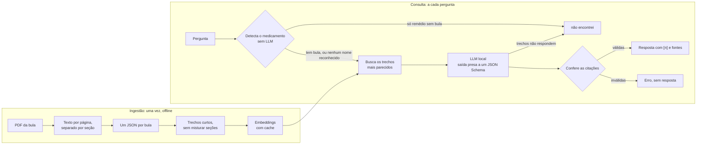

# FarmaRAG

Assistente de bulas para o balcão da farmácia, com IA rodando localmente.

> Projeto de portfólio, em construção. Não substitui o farmacêutico nem a leitura da bula.

## Objetivo

No balcão, a dúvida sobre um medicamento precisa de resposta rápida, mas a bula é longa e o PDF é difícil de pesquisar. O FarmaRAG encontra o trecho certo e responde com a fonte ao lado, para o farmacêutico ou atendente conferir.

Três regras definem o projeto:

- **Só responde com base nas bulas indexadas.** Sem conhecimento próprio do modelo.
- **Toda frase da resposta traz a fonte:** medicamento, seção, página e data da versão da bula.
- **Prefere dizer "não encontrei" a inventar.** Em saúde, recusar é um resultado válido, não um erro.

Tudo roda na própria máquina com [Ollama](https://ollama.com), sem API paga e sem nuvem.

Como objetivo de portfólio, o projeto mostra a construção de um RAG de ponta a ponta: ingestão dos documentos, busca, geração com citação verificada e um benchmark próprio para medir a qualidade.

Exemplo de resposta, com a bula de um medicamento inventado usado nos testes:

```text
> Exemplol pode ser usado junto com ibuprofeno?

RESPOSTA
O uso com anti-inflamatórios não esteroidais, como o ibuprofeno, pode reduzir o efeito
anti-hipertensivo da exemplina e piorar a função renal [1].

TRECHOS ENVIADOS AO MODELO (* = citado na resposta)
 *[1] Exemplol 50 mg | Interações medicamentosas | p. 2 | bula de 15/03/2025 | semelhança 0.71
  [2] Exemplol 50 mg | Contraindicações | p. 2 | bula de 15/03/2025 | semelhança 0.61
  [3] Exemplol 50 mg | Indicações | p. 1 | bula de 15/03/2025 | semelhança 0.59

> Dipirona pode ser usada na gravidez?
NÃO ENCONTREI: não tenho a bula desse medicamento
```

## Skills utilizadas

| Área | O que foi aplicado |
|---|---|
| RAG | Divisão do documento em trechos por seção, embeddings multilíngues (`bge-m3`), busca por similaridade de cosseno, filtro por princípio ativo, resposta com citação |
| LLM local | Ollama, modelo pequeno (`qwen2.5:1.5b`), saída estruturada com JSON Schema, engenharia de prompt para modelo pequeno |
| Confiabilidade da resposta | Validação das citações no código, recusa antes de chamar o modelo, catálogo de erros com código próprio para cada falha |
| Python | Pydantic e pydantic-settings para contratos e configuração, `Protocol` para interfaces, numpy para a busca vetorial, SQLite para cache, SQLAlchemy para os modelos do banco |
| Tratamento de dados | Extração de texto de PDF (`pdfplumber`), separação por seções com expressões regulares, normalização de nomes de medicamentos, tolerância a erro de digitação |
| Dados públicos | Processamento dos dados abertos da ANVISA, validação do arquivo antes do uso, registro de procedência com SHA-256, geração determinística do catálogo |
| Testes | pytest, 99 testes automáticos, modelo substituído por um falso para testar o fluxo sem depender do Ollama |
| Engenharia | Configuração por `.env`, dataset versionado no Git, Docker Compose, registro escrito das decisões de projeto |

## Como foi construído

A construção seguiu da parte mais arriscada para a mais previsível: primeiro a IA, que é a novidade, e só depois a API e a tela.



1. **Especificação e decisões.** O projeto partiu de uma especificação ([`FarmaRAG.pdf`](FarmaRAG.pdf)). Tudo que mudou ao implementar, e por quê, foi registrado em [`docs/DECISOES.md`](docs/DECISOES.md).
2. **Catálogo de medicamentos.** Os dados abertos da ANVISA viraram um catálogo de 6.999 pares de nome comercial e princípio ativo, usado para reconhecer o medicamento na pergunta. A procedência de cada arquivo está em [`data/FONTES.md`](data/FONTES.md).
3. **Ingestão.** Scripts que leem a bula, separam o texto nas seções padronizadas pela ANVISA (indicações, contraindicações, interações, posologia e outras), dividem cada seção em trechos e calculam os embeddings, guardados em cache para não refazer o que não mudou.
4. **Busca.** Similaridade de cosseno em memória, atrás de uma interface, para que a troca por um banco vetorial não exija mudar o resto do código. Quando a pergunta cita dois medicamentos, a busca divide os trechos entre eles.
5. **Geração com citação.** O modelo devolve uma lista de afirmações, cada uma com o número do trecho de onde saiu. O marcador `[n]` é montado no código, e a resposta só é entregue se toda citação apontar para um trecho que foi realmente enviado.
6. **Testes.** Cada parte foi escrita com testes automáticos, e o fluxo completo foi testado pelo terminal com uma bula inventada.

Aprendizados que moldaram o código:

- **Detectar o medicamento antes de chamar o modelo.** Perguntar sobre um remédio sem bula indexada é o caso mais comum, e a resposta certa ("não tenho essa bula") não precisa de geração. O nome mais longo vence: "Buscopan Composto" não é respondido com a bula do Buscopan.
- **Modelo pequeno não cita de forma confiável dentro do texto.** Pedindo `[1]` no meio da frase, respostas corretas eram recusadas pela validação. Pedindo afirmações separadas e montando a citação no código, o problema sumiu.
- **Nenhum exemplo de resposta no prompt.** O modelo copiava o exemplo como se fosse a resposta.
- **O dataset em arquivo é a fonte da verdade.** Bulas e trechos ficam em JSON versionado; banco e cache podem ser apagados e recriados a partir deles.

## O que vamos fazer

Hoje o fluxo completo funciona pelo terminal, com uma bula de teste. Os próximos passos, em ordem:

1. **Bulas reais.** Indexar as bulas do profissional de saúde dos 40 medicamentos mais comuns no balcão, ajustando a separação de seções ao que cada fabricante escreve.
2. **Verificação da resposta.** Hoje a validação garante que a citação existe, não que a frase está sustentada pelo trecho. A próxima mudança é checar no código se todo número, dose e unidade da resposta aparece no trecho citado, com novas tentativas quando falhar.
3. **Perguntas de esclarecimento.** Quando o nome for ambíguo ou nenhum medicamento for reconhecido, o sistema pergunta de volta em vez de arriscar. Nunca pergunta dados do paciente.
4. **Benchmark próprio.** Cinquenta perguntas com resposta conhecida, dez delas sem resposta nas bulas, para medir recall da busca, fidelidade, citação correta, recusa correta e latência, comparando modelos e tamanhos de trecho.
5. **API.** FastAPI com endpoints de pergunta, medicamentos e histórico de consultas, usando MySQL agora e PostgreSQL com pgvector depois.
6. **Frontend.** Tela em React com a resposta, as citações clicáveis, as fontes ao lado e o histórico.
7. **Entrega.** Docker Compose, resultados do benchmark publicados aqui e um vídeo curto de demonstração.
